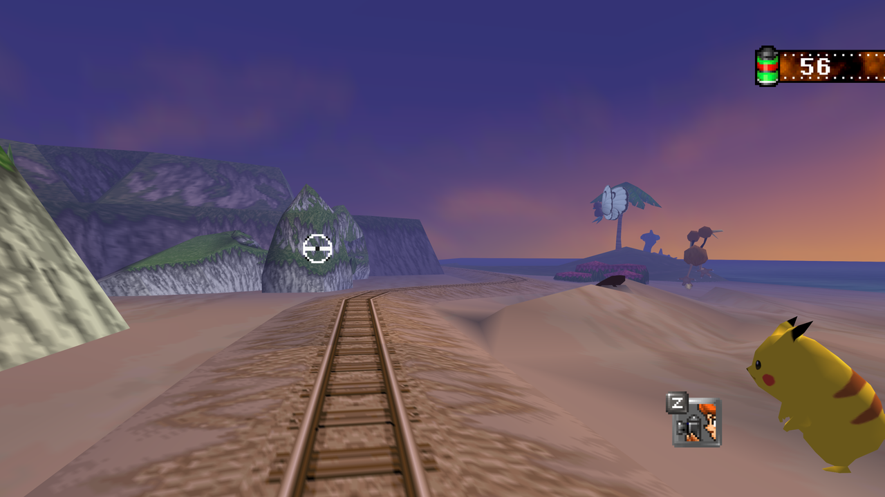
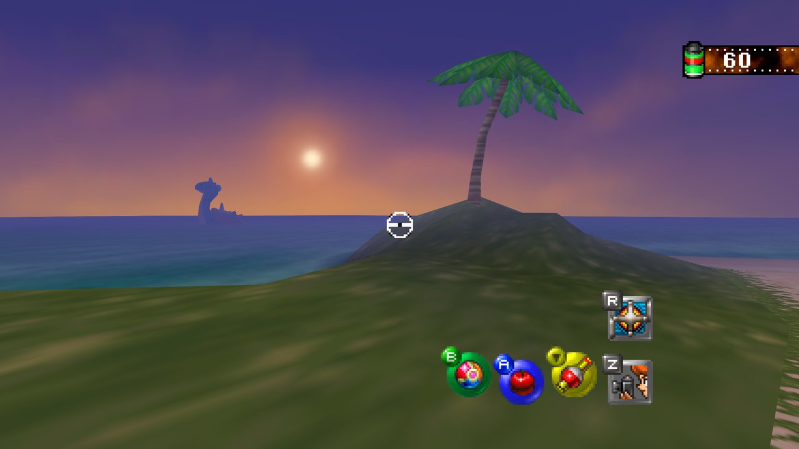
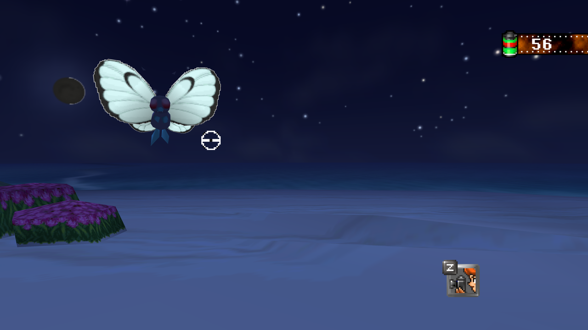
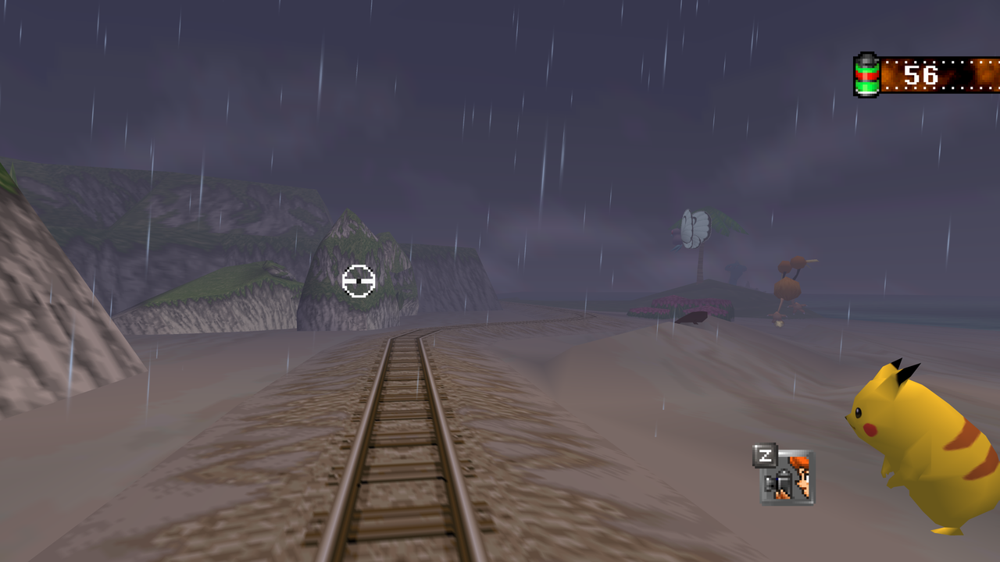
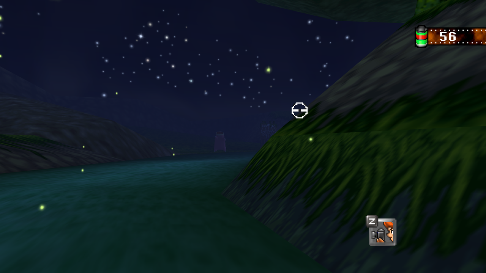
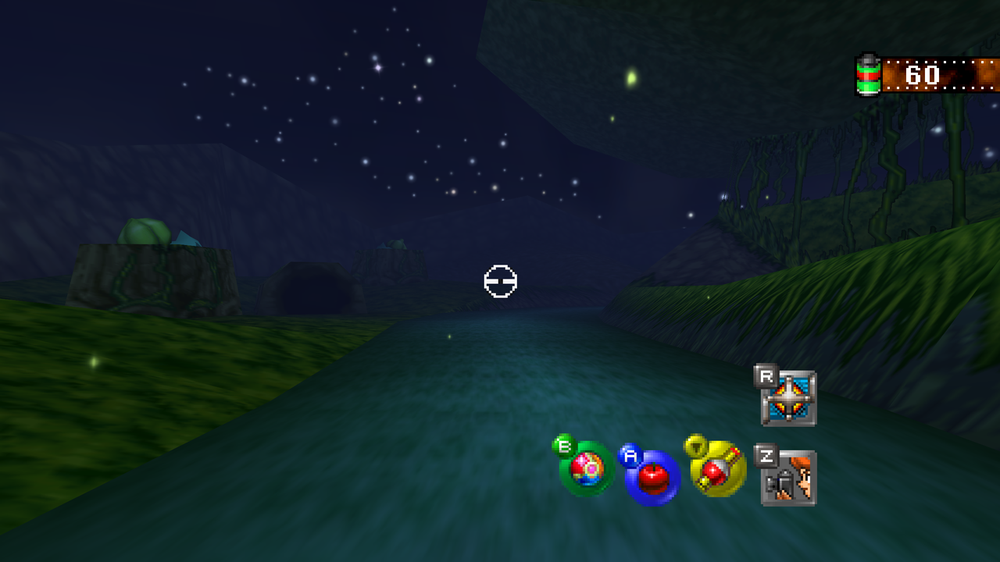
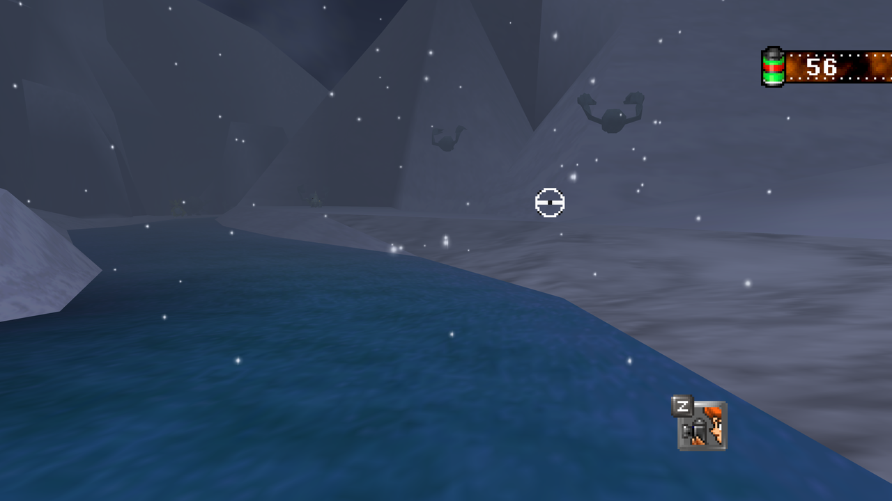
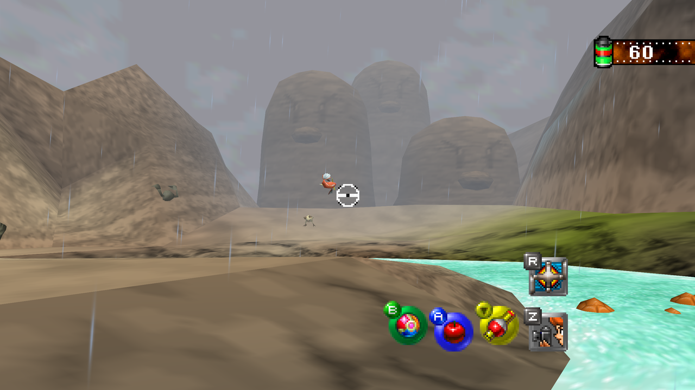
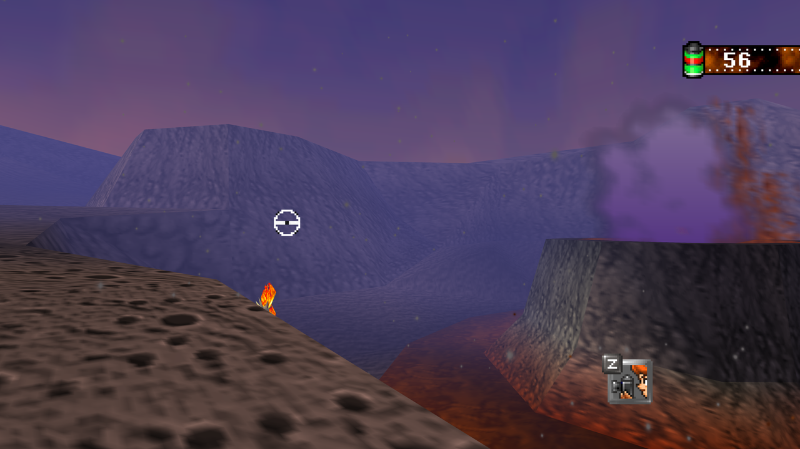
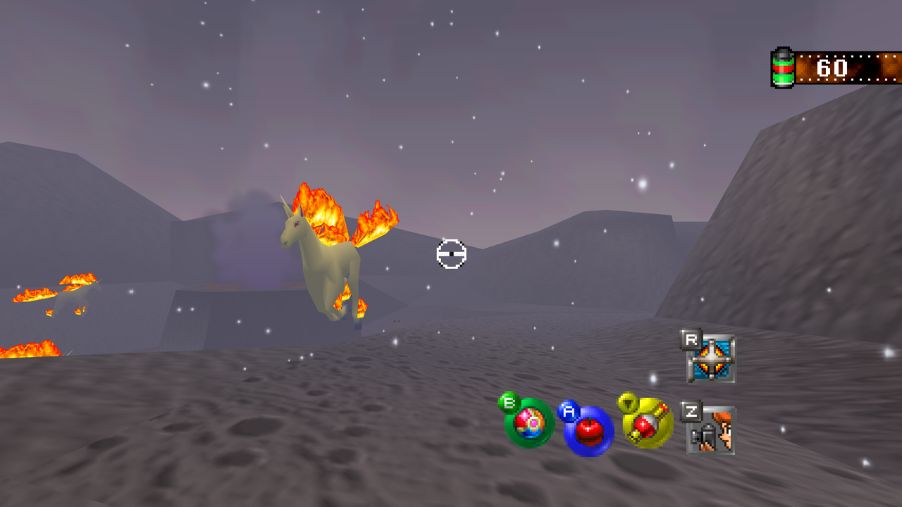

# Island Skies

A mod for [Snap64 Recomp](https://github.com/JackandBeans/Snap64Recomp), the
native PC port of Pokémon Snap.

The island's sky at any hour and in any weather. Night, sunset, dawn, a
dusk that falls during the ride, or live: the island follows your own clock,
day and night, under weather of its own that holds from one ride to
the next and turns during a ride when its time comes. Stars that twinkle,
a moon with its glint on the water, meteor showers on clear nights and an
aurora on some of them, the Volcano lit by its lava; rain, storms with lightning and snow that lies,
on every course, and ash over the Volcano; at dawn a mist lies on the River
and the Valley and lifts as the day comes. By day the island is exactly as
the cartridge draws it, and photos keep the sky of their instant.

## Pictures

The Beach at sunset: the sun over the sea, Pikachu on the sand.

Lapras out on the sea at sunset, the sun low over the water.

The Beach at night: Butterfree under the stars.

A storm on the Beach: rain on the wind under a gray sky.

The River at night: fireflies over the water under the stars.

The River at night, down the water: the stars overhead, fireflies along the banks.

The Valley in snow: the rapids under a snowfall, the banks white.

The Valley in rain: the cliffs gray in the mist, Magikarp leaping by the rapids.

The Volcano at sunset: the crater's plume over the lava, ash on the wind.

The Volcano in snow: Rapidash running through the falling snow.

## Installing

Mod managers do not support Snap64 Recomp. Use **Manual Download** on this
page, then drop the zip on the game window, or put it in the port's `mods`
folder beside `Snap64Recomp.exe` (on a Mac, in `~/Library/Application
Support/Snap64 Recomp/`). The mod loads the next time the game starts.
Needs Snap64 Recomp 1.1.3 or later. Options > Mods turns it on or off.

## Setting it up

In the game, open Options > Mods, select Island Skies and press A for
its details, then A again for its options. The first row is **Setup**:

- **Simple** is two more rows. **Time**: Night (the default), Sunset,
  Dawn, Dusk (the sun sets during the ride), Day, or Your clock.
  **Weather**: Island's own (rain on the River, clear elsewhere), Clear,
  Rain, Storm, Snow, or Random. A weather chosen falls on every course:
  snow lies on the Beach's sand as on the Valley's banks, with the surf
  line left wet and bare, and dusts the Volcano's warm rock without
  settling deep. Snow lies by the slope: flat ground white, rock faces
  their own rock, a snow line between. The Tunnel's open-air start, the
  slope up to the cave's mouth, takes the weather like any course, under
  its painted sky, which takes the weather and the hour as the other
  courses' skies do: it is a thing of the world there, hidden by the rock
  once the cart is under the roof and seen through the mouth looking
  back. Under the roof nothing falls, and the cave keeps the hour's own
  light and fog: the weather's stay with the open air. At the far end the
  weather waits past the last arch, seen through it as the gate comes.
  Day is the cartridge's own day, and the weather chosen falls on it as
  it does under Live. Dawn lays a mist on the River and the Valley, in
  the fog and on the water and its banks, that thins as the ride goes;
  under Live it gathers through the night's last hour, lies thickest as
  the sky pinks, and lifts as the day comes. Rain and snow have their
  own gray instead. On a clear Night a meteor shower falls: streaks every
  few seconds from one point of the sky, each with its own length and
  brightness. On some nights, one ride in three, an aurora stands low in
  the sky a quarter turn around from where the sun sets: two curtains of
  light, each a bright band at a folded foot with a rose fringe under it
  and fine rays rising from it, green to violet, that drift, brighten,
  fade and shimmer, the stars showing through them.
- **Live** is your clock and the island's own weather. Its only other
  rows are Sun, Latitude and Longitude, which set the sun's hours (see
  How Live works).
- **Custom** opens every row: each course's hour and weather, and the fine
  switches.

A change on the page takes effect as the next ride starts; a ride under
way keeps the sky it started with. A photo keeps the sky it was taken
under: the album and Professor Oak's review show it at its own hour and
weather, with its aurora if the night had one, whatever the rows say by
then. Photos taken before 1.1.2 carry
no such note and follow the rows, as they always did.

Under Live, or with a course on Your clock, the mod's details page
(Options > Mods, Island Skies) says what it is doing right now: the hour
and its light, the weather, the sun's hours, and, under Live, the next
change of weather when one is near. As such a ride starts, a line at the
top of the screen says the hour and the sky for four seconds, and a
change of weather during a ride is announced the same way.

## How Live works

The island's hours, the same all year unless the Sun row says
otherwise:

- 05:00 to 05:45, the night turns to dawn: the stars and the moon go, the
  sun comes up pink.
- 05:45 to 06:45, the dawn turns to day.
- 06:45 to 17:30, day, as the cartridge has it.
- 17:30 to 18:30, the day turns to sunset: the sky warms and the sun comes
  down to the horizon.
- 18:30 to 19:15, dusk: the sun sinks and fades, the stars rise, the moon
  comes.
- 19:15 to 05:00, night.

A ride that crosses one of these hours changes as it goes. A photo's world
keeps the hour of its instant.

The weather comes from the date and the hour, so every ride of the same
half hour has the same weather and the next ride finds what the last one
left: mostly clear, rain about a quarter of the time, a storm one hour in
eight, a change about every two hours. A change comes some minutes into
its half hour and takes a minute and a half, during a ride when it falls
in one: the sky grays and the stars go, then the rain comes; clearing, the
rain thins first and the stars return. The odds lean with the season, and
in the winter months the island's rain is snow, on every course. The
Volcano adds its own: on three days in eight, ash from the eruption fills
its clear hours.

Every clear night has a meteor shower, streaks every few seconds from one
point of the sky. On the peak nights of the year's own showers, the
Quadrantids (Jan 3), the Lyrids (Apr 22), the Eta Aquariids (May 5), the
Perseids (Aug 12), the Orionids (Oct 21), the Leonids (Nov 17) and the
Geminids (Dec 13), the streaks come at that shower's pace, thickest for
the Geminids and the Perseids, and the details page names the shower.

An aurora comes by the latitude. With **By latitude** it stands most
nights beyond 55 degrees north or south, one night in two to 45, one in
five to 35, one in twelve to 25, and about one in forty nearer the
equator; south of the equator it stands on the other side. With Fixed
hours it is one night in three. A night that has it has it all night,
past midnight, and the details page says so.

The **Sun** row sets the hours by the sun instead: with **By latitude**
the **Latitude** row (degrees north, minus for south) gives sunrise and
sunset for today's date, with no internet, and makes the dawn and the dusk
as long as the twilight is there, short at the equator and long in a far
northern June. The **Longitude** row (degrees east, minus for west) puts
solar noon where your clock has it; at 0 the mod takes your clock's zone,
which is within half an hour. The moon shows its phase by the date, new
to full and back, and south of the equator its lit side is the other one.

## Custom's rows

- **Beach, Tunnel, River, Volcano, Valley**: each course's own hour. The
  Tunnel's stars, moon and suns stand over its open ends, behind its
  hills and its rock; under the roof the cave keeps its own light and
  the color where it opens to the air.
- **Beach Weather, River Weather, Valley Weather, Volcano Weather, Tunnel
  Weather**: each course's own sky, clear, rain, a storm or snow; the
  Volcano can have ash as well; the Tunnel's falls over its open-air
  start, up to the cave's mouth, and again past the arch at its far end.
- **Effects at Night**: splashes, dust and spray take the night's light,
  or keep their day colors.
- **Water Glow**: the moon's glint on the water and the River's fireflies.
- **Dawn Mist**: at dawn on the River and the Valley, wisps on the water
  and a paler, nearer fog, or the plain dawn.
- **Aurora**: curtains of light low in the sky on clear nights, some
  nights (one ride in three), every night, or never. The Tunnel has none.
- **Moonlight on Pokémon**: the scene's light leans toward the moon, or
  stays where the game puts it.
- **Night Sounds**: insects chirping in the dark on a clear night.
- **Lightning**: Gentle (the default) keeps the bolt and the thunder but
  dims the flash that fills the screen, for sensitive eyes; Full is the
  storm as drawn; Off leaves a storm its rain and wind.

## Source

[github.com/JackandBeans/Snap64RecompMods](https://github.com/JackandBeans/Snap64RecompMods),
GPLv3.
